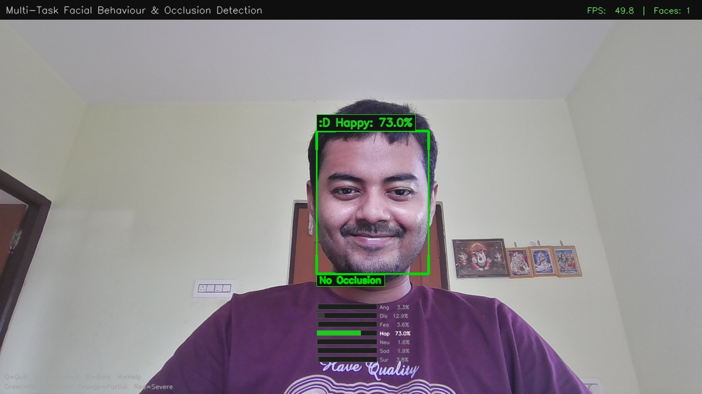
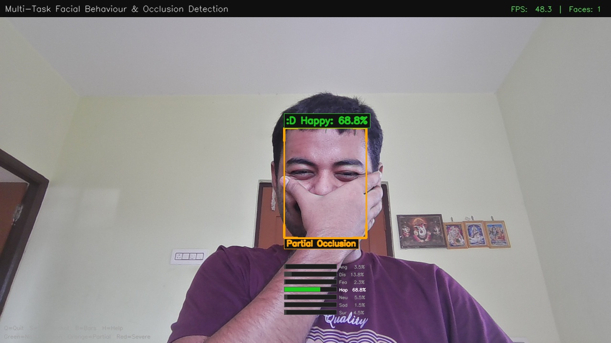
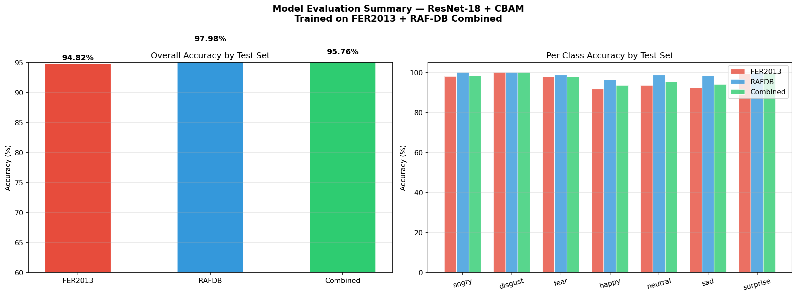
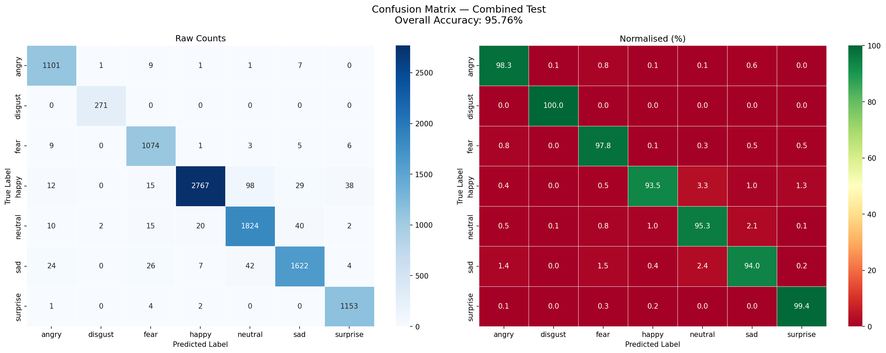
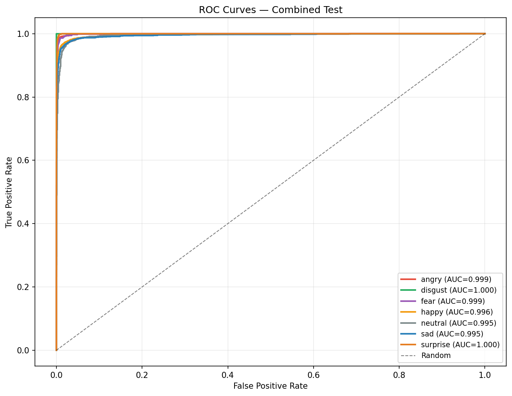

# 🎭 Multi-Task Facial Behaviour and Occlusion Detection

> **A real-time deep learning system for simultaneous facial emotion recognition and facial occlusion detection using ResNet-18 + CBAM, MTCNN, and MediaPipe FaceMesh.**

<p align="center">


</p>

---

## 📑 Table of Contents

- [🎭 Multi-Task Facial Behaviour and Occlusion Detection](#-multi-task-facial-behaviour-and-occlusion-detection)
  - [📑 Table of Contents](#-table-of-contents)
  - [📌 Project Overview](#-project-overview)
  - [✨ Features](#-features)
  - [📸 Live Demo](#-live-demo)
    - [Real-Time Emotion Recognition](#real-time-emotion-recognition)
    - [Real-Time Occlusion Detection](#real-time-occlusion-detection)
- [🏗️ System Architecture](#️-system-architecture)
- [🧠 Deep Learning Architecture](#-deep-learning-architecture)
    - [Model Highlights](#model-highlights)
- [📊 Experimental Results](#-experimental-results)
  - [Overall Evaluation](#overall-evaluation)
  - [Combined Confusion Matrix](#combined-confusion-matrix)
  - [ROC Curves](#roc-curves)
- [📁 Project Structure](#-project-structure)
- [⚙ Installation](#-installation)
  - [1️⃣ Clone the Repository](#1️⃣-clone-the-repository)
  - [2️⃣ Create the Conda Environment](#2️⃣-create-the-conda-environment)
  - [3️⃣ (Alternative) Install Using pip](#3️⃣-alternative-install-using-pip)
- [📥 Dataset Setup](#-dataset-setup)
  - [Download Datasets](#download-datasets)
  - [Directory Structure](#directory-structure)
  - [When Are These Datasets Required?](#when-are-these-datasets-required)
- [🚀 Usage](#-usage)
  - [Run the Real-Time System](#run-the-real-time-system)
  - [Evaluate the Model](#evaluate-the-model)
- [🛠 Tech Stack](#-tech-stack)
- [🧪 Training Configuration](#-training-configuration)
- [🔮 Future Improvements](#-future-improvements)
- [👨‍💻 Author](#-author)
- [📄 License](#-license)

---

## 📌 Project Overview

This project presents a **real-time facial analysis system** capable of performing **two tasks simultaneously**:

- 😊 Facial Emotion Recognition
- 😷 Facial Occlusion Detection

The system combines a **ResNet-18 backbone enhanced with CBAM (Convolutional Block Attention Module)** for emotion recognition and **MediaPipe FaceMesh** for occlusion estimation. Faces are detected using **MTCNN**, enabling robust real-time performance on CPU.

The project was developed as an **MCA Final Year Project** and evaluated using the **FER2013** and **RAF-DB** datasets.

---

## ✨ Features

- 🎭 **Real-Time Facial Emotion Recognition** using a ResNet-18 backbone enhanced with CBAM (Convolutional Block Attention Module).
- 😷 **Facial Occlusion Detection** using MediaPipe FaceMesh with region-based analysis.
- 👤 **Robust Face Detection** powered by MTCNN for accurate face localization.
- ⚡ **Real-Time Inference** optimized to run on CPU without requiring a dedicated GPU.
- 📊 **Confidence Visualization** with emotion probability bars and prediction scores.
- 📷 **Screenshot Capture** for saving live detection results during execution.
- 📈 **Comprehensive Evaluation** on FER2013 and RAF-DB datasets.
- 🧩 **Modular Project Structure** with separate training, evaluation, model, and inference components.

---

## 📸 Live Demo

### Real-Time Emotion Recognition

<p align="center">
  
</p>

### Real-Time Occlusion Detection

<p align="center">
  
</p>

The system performs **simultaneous emotion recognition and facial occlusion detection** from a live webcam stream. It detects faces using **MTCNN**, classifies facial expressions using **ResNet-18 + CBAM**, and estimates occlusion severity using **MediaPipe FaceMesh**.


---

# 🏗️ System Architecture

The complete workflow of the proposed system is illustrated below.

<p align="center">

```text
                  Webcam / Video Stream
                           │
                           ▼
                  MTCNN Face Detection
                           │
                           ▼
                  Face Crop (224 × 224)
                           │
          ┌────────────────┴────────────────┐
          │                                 │
          ▼                                 ▼
 ResNet-18 + CBAM                  MediaPipe FaceMesh
 Emotion Recognition               Occlusion Detection
          │                                 │
          └────────────────┬────────────────┘
                           ▼
                Real-Time Visualization
      (Emotion + Confidence + Occlusion Status)
```

</p>

The application performs **two independent tasks simultaneously**:

- **Emotion Recognition Branch**: Uses a ResNet-18 backbone enhanced with CBAM to classify facial expressions into seven emotion categories.
- **Occlusion Detection Branch**: Uses MediaPipe FaceMesh landmarks and facial region analysis to estimate the severity of facial occlusion.
- The outputs from both branches are merged and displayed in real time.

---

# 🧠 Deep Learning Architecture

The emotion recognition model is based on a **ResNet-18 backbone** enhanced with the **Convolutional Block Attention Module (CBAM)**. The attention mechanism enables the network to focus on the most informative facial regions while suppressing irrelevant features, improving robustness under challenging conditions.

```text
                Input Face (224 × 224 × 3)
                           │
                           ▼
                 ResNet-18 Backbone
                           │
        ┌─────────────────────────────────┐
        │  CBAM Attention Module          │
        │  • Channel Attention            │
        │  • Spatial Attention            │
        └─────────────────────────────────┘
                           │
                           ▼
                Global Average Pooling
                           │
                           ▼
                     Dropout (0.4)
                           │
                           ▼
                Fully Connected Layer
                           │
                           ▼
              Softmax (7 Emotion Classes)
                           │
                           ▼
 Angry • Disgust • Fear • Happy
 Neutral • Sad • Surprise
```

### Model Highlights

- **Backbone:** ResNet-18
- **Attention Module:** CBAM (Channel + Spatial Attention)
- **Input Resolution:** 224 × 224 RGB
- **Output Classes:** 7 Facial Emotions
- **Framework:** PyTorch
- **Inference Device:** CPU / CUDA (Automatically Detected)


---

# 📊 Experimental Results

The model was evaluated on the **FER2013** and **RAF-DB** datasets using multiple evaluation metrics.

## Overall Evaluation

<p align="center">

</p>

---

## Combined Confusion Matrix

<p align="center">

</p>

---

## ROC Curves

<p align="center">

</p>

The evaluation demonstrates the effectiveness of the proposed multi-task system across multiple benchmark facial expression datasets.


---

# 📁 Project Structure

```text
Multi-Task-Facial-Behaviour-and-Occlusion-Detection/
│
├── assets/
│   ├── demo/
│   ├── diagrams/
│   └── results/
│
├── fer2013/
│   └── test/
│
├── rafdb/
│   └── test/
│
├── results/
│
├── debug_occlusion.py
├── evaluate.py
├── kaggle_train_p100.py
├── model.py
├── occlusion_detector.py
├── realtime_system.py
│
├── fer_resnet18_cbam.pth
│
├── requirements.txt
├── requirements_exact.txt
├── environment.yml
├── README.md
└── .gitignore
```

---

# ⚙ Installation

## 1️⃣ Clone the Repository

```bash
git clone https://github.com/YOUR_USERNAME/Multi-Task-Facial-Behaviour-and-Occlusion-Detection.git

cd Multi-Task-Facial-Behaviour-and-Occlusion-Detection
```

---

## 2️⃣ Create the Conda Environment

```bash
conda env create -f environment.yml

conda activate fer_env
```

---

## 3️⃣ (Alternative) Install Using pip

```bash
pip install -r requirements.txt
```

---

# 📥 Dataset Setup

This project uses the following benchmark facial expression datasets for **model evaluation**:

- **FER2013**
- **RAF-DB**

> **Note:** The datasets are **not included** in this repository due to licensing restrictions and repository size considerations.

## Download Datasets

- **FER2013:** https://www.kaggle.com/datasets/msambare/fer2013
- **RAF-DB:** http://www.whdeng.cn/RAF/model1.html

## Directory Structure

After downloading the datasets, organize them as follows:

```text
fer2013/
└── test/

rafdb/
└── test/
```

## When Are These Datasets Required?

| Task | Dataset Required |
|------|:----------------:|
| Real-Time Emotion & Occlusion Detection (`realtime_system.py`) | ❌ No |
| Model Evaluation (`evaluate.py`) | ✅ Yes |

The trained model (`fer_resnet18_cbam.pth`) is already included in this repository, allowing the real-time application to run immediately without downloading any datasets.

---

# 🚀 Usage

## Run the Real-Time System

```bash
python realtime_system.py
```

The application will:

- Detect faces using **MTCNN**
- Recognize facial emotions using **ResNet-18 + CBAM**
- Estimate facial occlusion using **MediaPipe FaceMesh**
- Display predictions and confidence scores in real time

---

## Evaluate the Model

```bash
python evaluate.py
```

This generates:

- Confusion Matrix
- ROC Curves
- Per-Class Accuracy
- Classification Report
- Evaluation Summary


---

# 🛠 Tech Stack

| Category | Technologies |
|----------|--------------|
| Programming Language | Python 3.11 |
| Deep Learning | PyTorch, Torchvision |
| Computer Vision | OpenCV, MediaPipe, MTCNN |
| Model Architecture | ResNet-18 + CBAM |
| Face Detection | MTCNN |
| Occlusion Detection | MediaPipe FaceMesh |
| Data Visualization | Matplotlib, Seaborn |
| Machine Learning | Scikit-learn |
| Image Processing | Pillow |
| Environment | Anaconda |
| Version Control | Git & GitHub |


---

# 🧪 Training Configuration

| Parameter | Value |
|-----------|-------|
| Backbone | ResNet-18 |
| Attention Module | CBAM |
| Dataset | FER2013 |
| Input Size | 224 × 224 |
| Epochs | 40 |
| Batch Size | 128 |
| Optimizer | AdamW |
| Learning Rate | 1e-3 |
| Scheduler | CosineAnnealingLR |
| Loss Function | CrossEntropyLoss |
| Framework | PyTorch |


---

# 🔮 Future Improvements

Future enhancements that can be explored include:

- Multi-face emotion recognition.
- Temporal emotion tracking across video frames.
- Support for additional facial expression datasets.
- Improved occlusion handling using deep learning–based segmentation.
- ONNX/TensorRT optimization for faster inference.
- Web-based deployment using Flask or FastAPI.
- Dockerized deployment for reproducibility.


---

# 👨‍💻 Author

**Biswojit Sahoo**

MCA Student  
ITER, Siksha 'O' Anusandhan (SOA) University

- GitHub: https://github.com/biswojit-11
- LinkedIn: https://www.linkedin.com/in/biswojitsahoo11

If you found this project helpful, consider giving it a ⭐ on GitHub.


---

# 📄 License

This project is released under the **MIT License**.

See the `LICENSE` file for details.
